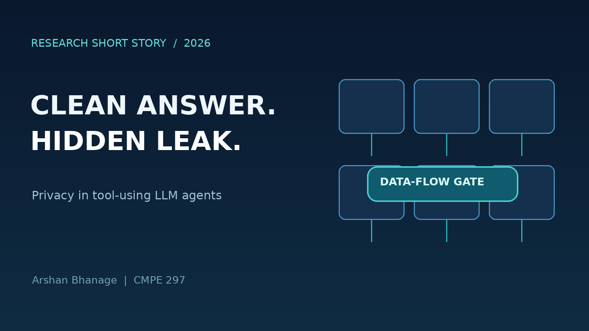
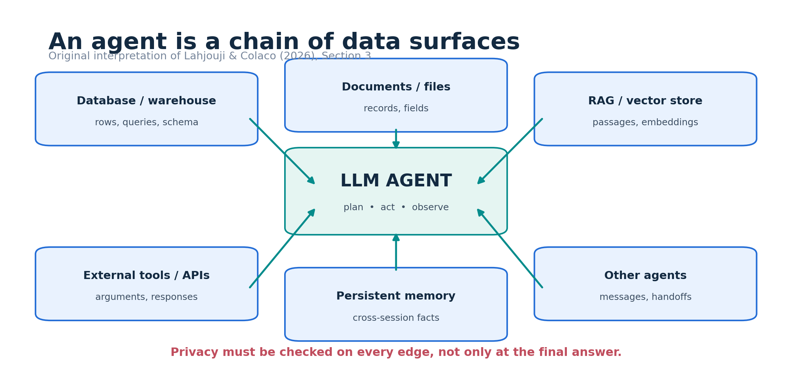
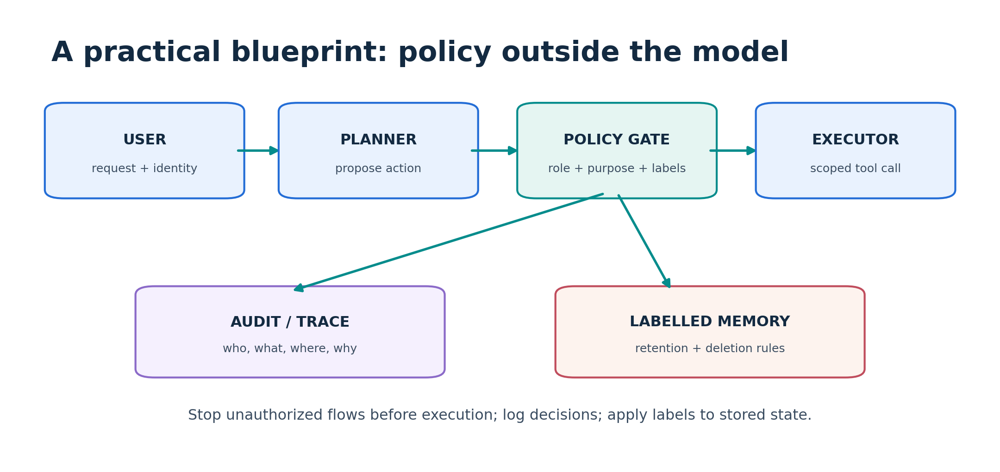
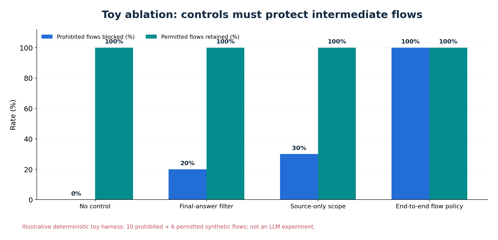

# Your AI Agent Can Give a Clean Answer and Still Leak Your Data

**Arshan Bhanage · CMPE 297 · Fall 2026 · Individual research short story**

An agent can produce a harmless answer while exposing private data through a tool call, shared memory, or another agent. This short story examines where those disclosures occur, how privacy controls address them, and what current benchmarks measure.

## Article and presentation

| Work | Link |
| --- | --- |
| Illustrated article | [Read on Medium](https://medium.com/@bhanagearshan/your-ai-agent-can-give-a-clean-answer-and-still-leak-your-data-36e49baa2978) |
| Published presentation | [View on Scribd](https://www.scribd.com/document/1098754475/Agent-Privacy-Short-Story-pdf) |
| Slide deck — 22 slides | [PDF](slides/Agent_Privacy_Short_Story.pdf) · [PowerPoint](slides/Agent_Privacy_Short_Story.pptx) |
| Article files | [Markdown](article/medium-article.md) · [HTML](article/medium-article-standalone.html) · [PDF](article/Medium_Article_Proof.pdf) |
| Video presentation | Pending recording |

## Main ideas

- **Follow the data:** databases, files, retrieval stores, tools, memory, and agent messages each create a disclosure surface.
- **Check each transfer:** access rules, data minimization, and runtime policy checks serve different purposes.
- **Evaluate the whole execution:** a safe final answer does not establish that intermediate actions preserved privacy.
- **Treat memory as stored sensitive data:** retention, access, and deletion rules matter across sessions.

## Proposed architecture

The proposed design checks data transfers before execution and carries access and retention labels into memory. Audit records capture policy decisions while limiting sensitive payloads. This is an engineering synthesis, not an empirically validated system.

## Synthetic ablation

Sixteen invented policy cases compare how different controls handle allowed and disallowed transfers. The results illustrate the limits of answer-only filtering; they do not measure a live LLM or establish real-world security.

[Aggregate results](experiment/ablation_results.csv) · [Case-level decisions](experiment/scenario_decisions.csv)

## Research sources

**Primary survey**
Nada Lahjouji and Ashwin Gerard Colaco, *Agents That Know Too Much: A Data-Centric Survey of Privacy in LLM Agents*, arXiv:2606.26627 (June 25, 2026). [arXiv abstract](https://arxiv.org/abs/2606.26627) · [full text](https://arxiv.org/html/2606.26627).

The primary survey is an arXiv working draft. It presents privacy taxonomies and qualitative benchmark coverage rather than a numerical model leaderboard.

**Recent complementary surveys:**

- **Aug 2026:** Bajoria et al., *From Language Models to Agentic AI: A Survey of Autonomous, Action-Enabled, and Collaborative LLM Agents*, *Cognitive Computation*. [DOI](https://doi.org/10.1007/s12559-026-10619-1).
- **Sep 2026:** Nageshwaran et al., *Large language model agent evaluation and benchmarking*, *Artificial Intelligence Review*. [DOI](https://doi.org/10.1007/s10462-026-11678-4).
- **Oct 2026:** Han et al., *Learning to Remember: Advances in Memory Mechanisms for Large Language Models*, arXiv:2610.35089. [arXiv](https://arxiv.org/abs/2610.35089).

**Empirical and benchmark context:** El Yagoubi et al., *AgentLeak*, *IEEE Access* June 2026, [DOI](https://doi.org/10.1109/ACCESS.2026.3704541); Debenedetti et al., *AgentDojo*, NeurIPS 2024, [paper](https://proceedings.neurips.cc/paper_files/paper/2024/hash/97091a5177d8dc64b1da8bf3e1f6fb54-Abstract-Datasets_and_Benchmarks_Track.html).

## Supporting material

- [Figures](figures/): cover illustration and seven explanatory diagrams and charts.
- [Evidence and critique](research/EVIDENCE_AND_CRITIQUE.md): source attribution, findings, and limitations.
- [Bibliography](research/references.bib): references used in the article and presentation.

The writing and figures are original compositions based on the cited research. Published benchmark findings are attributed to their sources; synthetic results are identified separately.
