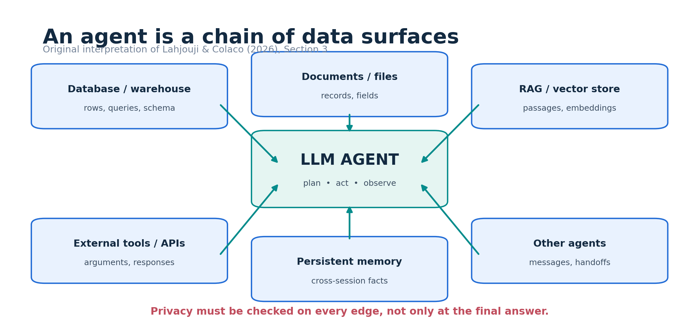
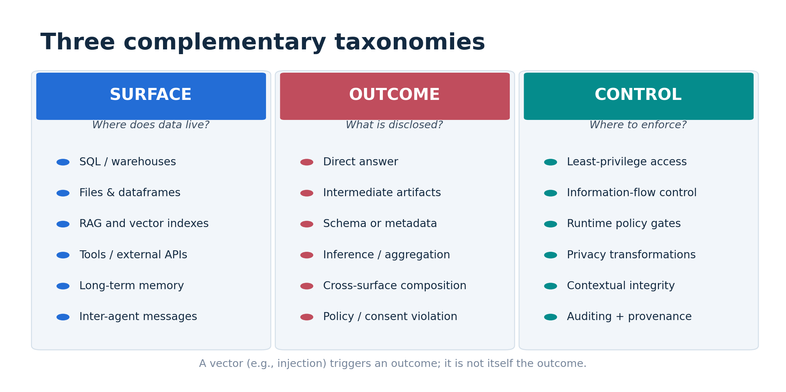
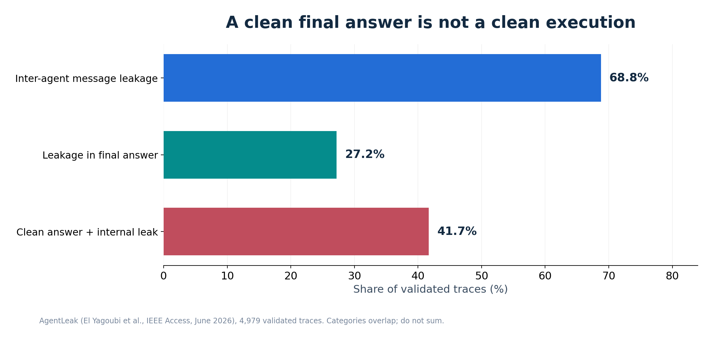
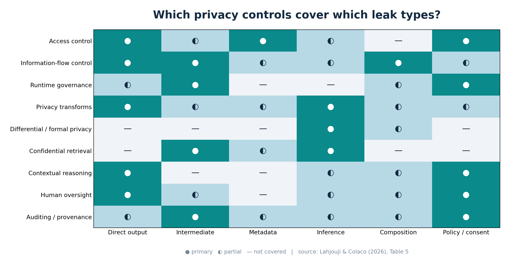
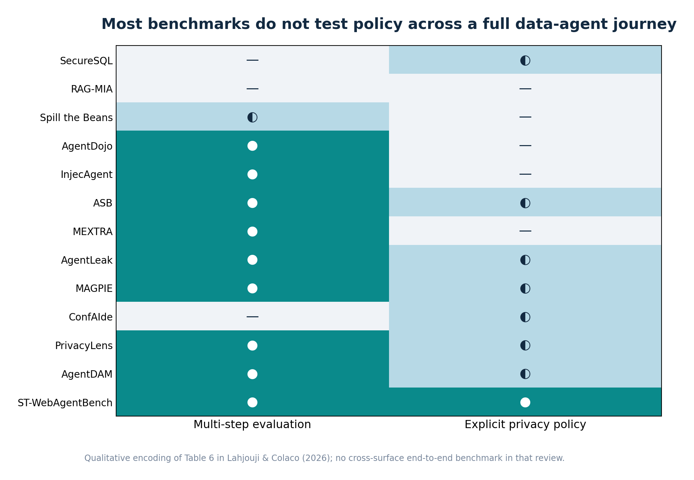
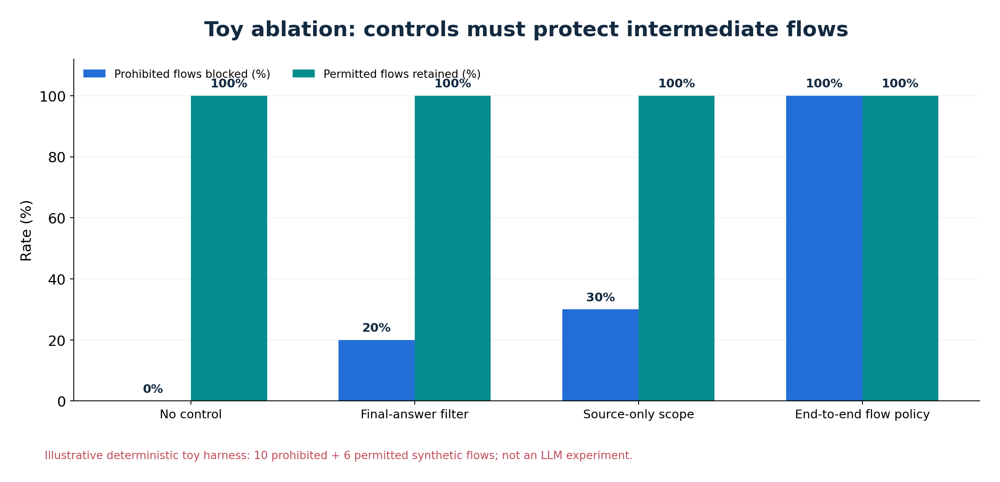
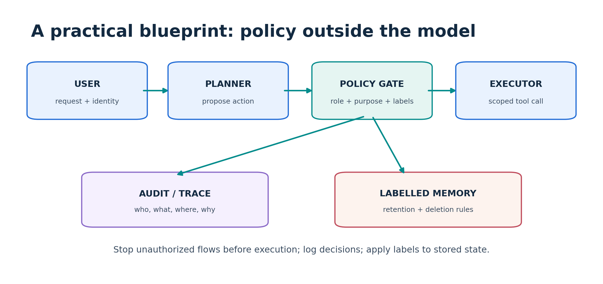

# Your AI Agent Can Give a Clean Answer and Still Leak Your Data

**A practical tour of agent privacy: six data surfaces, nine defense families, real benchmark evidence, and the architecture I would use in production**

*By Arshan Bhanage · Research short story · November 2026 · ~11-minute read*

A chatbot answers a question. An AI agent does considerably more: it searches files, queries a database, calls an API, remembers information, and sometimes asks another agent for help. That extra agency is useful—but it creates a privacy problem that is easy to overlook.

Imagine asking an internal assistant: “Can you summarize my order status?” The final reply contains only your order number and delivery date. Safe, right? Not necessarily. The assistant may have sent your entire customer record to a third-party tool to calculate that date, logged the raw database result, or placed details in shared memory that a different assistant can read tomorrow. A clean answer cannot tell us whether the journey was clean.

That is the central idea I took away from **“Agents That Know Too Much: A Data-Centric Survey of Privacy in LLM Agents”** by Nada Lahjouji and Ashwin Gerard Colaco (University of California, Irvine; posted June 25, 2026). Rather than starting with a catalogue of attacks, the authors start with **the places where data goes**. Their three connected taxonomies—data surfaces, disclosure outcomes, and governance mechanisms—offer a useful framework for building agent systems. [1]

I read this survey alongside three newer reviews and a peer-reviewed benchmark: an August 2026 survey of agent architectures [2], a September 2026 systematic review of agent evaluation [3], an October 2026 survey of LLM memory [4], and the June 2026 *AgentLeak* study [5]. I also built a small, reproducible **synthetic** ablation to illustrate why output filtering is only one piece of the solution. None of that toy experiment's results should be mistaken for measurements on a real LLM.

*Figure 1. Original adaptation of the six-surface taxonomy in Lahjouji and Colaco, Section 3 [1]. Every connection is a potential data flow. The figure is conceptual, not an instrumented trace.*

## The mental model: protect the execution, not just the reply

Most AI product demos show the user interface: input on the left, response on the right. The architecture between them is where privacy actually becomes complicated. A planner might construct SQL; the query returns rows; a retrieval engine adds document snippets; a tool receives arguments; a memory component saves context; and a second agent receives a handoff. Each operation transforms, copies, or moves information.

Consider an agent asked to estimate travel reimbursement. It may legitimately read an employee's expense amount, department, and policy limits. It probably does **not** need to copy the employee's address into an analytics request, expose salary records, or store the expense receipt indefinitely. The hard question is not simply “Can this user read this table?” It is: **Which values can move to which recipients, for which purpose, during this particular task?**

Lahjouji and Colaco enumerate six data surfaces: **databases and warehouses; tabular/file data; RAG corpora and vector stores; tools and external APIs; persistent agent memory; and multi-agent communication**. They define a different sensitive unit for each one—from SQL rows and schemas to embeddings, tool arguments, remembered facts, and inter-agent messages [1]. An effective privacy design must include all six when they are present in a workflow.

### Three taxonomies are more useful than one attack list

*Figure 2. My simplified reading guide to the source paper's three taxonomies [1]. It intentionally shows representative examples instead of every subcategory.*

The first axis is **surface**: where the data is held or transferred. The second axis is **disclosure outcome**: what kind of information is exposed. The paper distinguishes six outcomes: direct output leakage, intermediate-step leakage, schema/metadata exposure, inference/aggregation leakage, compositional leakage, and violations of purpose or consent. The third axis is **governance**: which control can block or limit the flow. The authors also separate outcomes from attack vectors—prompt injection, memory poisoning, excessive privileges, and compromised peers are ways a disclosure can be triggered, not the disclosure categories themselves [1].

This distinction matters. A prompt-injected document could cause raw data to be copied into a tool argument. If we only label the incident “prompt injection,” we may respond by strengthening a system prompt while leaving the API path unrestricted. If we label it **intermediate-step disclosure through an external tool**, the architecture-level fix becomes clearer: classify the data, restrict the recipient, inspect the action, and enforce a tool-call policy outside the model.

## What actually leaks? More than the obvious answer

The survey's outcome categories reveal several less-visible failure modes.

**Intermediate-step leakage** happens before the final answer. SQL queries can reveal the names or attributes of targeted records; tool-call arguments can contain personal information; diagnostic logs and inter-agent messages can copy raw values. Hiding a secret from the response does nothing to undo an earlier API call.

**Schema and metadata leakage** is subtler. A list of confidential table names, column names, index memberships, or retrieval scores can expose sensitive aspects of a dataset even when row values are masked.

**Inference and aggregation leakage** occurs when supposedly safe fragments combine into a sensitive fact. An agent that answers several overlapping aggregate queries may enable deduction of a small group's value. The individual releases can appear compliant while their combination is revealing.

**Compositional leakage** arises across workflow steps or sessions. A customer detail could be legitimately fetched for task A, saved to memory, and later transmitted during unrelated task B. Privacy is a property of the **entire path**, not a checklist applied independently to each tool.

**Policy and consent violations** can happen without displaying a traditionally secret field. A company may have permission to use an address to fulfill an order but not to send it to a marketing partner. Context and purpose are part of the rule.

The important takeaway is that **sensitivity alone does not determine permission**. Identity, context, purpose, destination, and retention all matter. The August 2026 agent survey makes a complementary point: autonomy, tool use, collaboration, and safety/governance need to be considered together in a deployable architecture [2].

## Evidence: the final response can underestimate leakage

A particularly useful complementary paper is **AgentLeak**, by Faouzi El Yagoubi, Godwin Badu-Marfo, and Ranwa Al Mallah, published in *IEEE Access* in June 2026 [5]. Its authors evaluate multi-agent interactions across healthcare, finance, legal, and corporate settings, instrumenting more than the final reply. The reported study covers **1,000 research scenarios, five language models, and 4,979 validated execution traces** [5].

*Figure 3. Measurements reported by AgentLeak [5]: inter-agent messages disclosed sensitive data in 68.8% of traces, the final output in 27.2%, and 41.7% of traces had a clean final answer despite an internal leak. The categories overlap and must not be added together.*

That **41.7% clean-output/internal-leak** result makes the abstract privacy concern concrete. If a test only examines the assistant's response, it can miss a large portion of exposure in this particular coordinator-worker evaluation. These are **study-specific** numbers, not general production rates and not a claim about all agents. The selected models, tasks, communication topology, instrumentation, and definition of a leak determine their interpretation.

I would not turn this into “multi-agent systems are always unsafe.” The study reports that final-output leakage is lower in the tested multi-agent configurations than in its single-agent baseline, while newly introduced internal channels raise the total surface of exposure [5]. An architectural design can reduce one category of risk and increase another. That is exactly why a single success percentage is inadequate.

## Which defenses should builders actually combine?

The source survey identifies **nine governance families**. Its comparison table labels a mechanism as a primary, partial, or non-applicable defense for six disclosure outcomes. I turned that qualitative matrix into an original visualization below. The marks are the **authors' categorical assessment**, not measured accuracy or a head-to-head leaderboard. [1]

*Figure 4. Adapted from the paper's Table 5 [1]. A filled dot means primary coverage in the survey, a half dot means partial coverage; it does not mean a product achieves guaranteed protection.*

Three families matter most in the architecture I would ship.

**1) Access control and purpose scoping.** Give the agent only the data required for the current task. Enforce authorization at the database/document layer—not inside a prompt that asks the model to behave. Row-level security, column masking, per-user credentials, and task-scoped tool permissions reduce what can be exposed in the first place. Purpose matters: access for order fulfillment is not automatically access for marketing.

**2) Information-flow control.** Track sensitivity labels as values move through a pipeline. If a restricted employee field is fetched from a database, its classification should follow the derived value through computation, memory, a tool call, and a peer-agent message. A deterministic policy gate can then reject a flow to an unauthorized destination. The survey identifies information-flow control as particularly important for intermediate and compositional disclosure—while also marking it as an **emerging**, not fully mature, approach in agent settings [1].

**3) Runtime governance and observability.** Before executing a tool call or storing memory, verify the actor, purpose, recipient, and data classification. Record a safe audit event containing the decision and its policy version, but avoid copying the raw sensitive payload into the logs. This provides both preventive enforcement and evidence when failures occur. An output sanitizer can remain as defense in depth; it should never be the only boundary.

Other families address different gaps: redaction and data minimization reduce the data released; differential privacy can constrain certain statistical disclosures; confidential retrieval aims to protect retrieval interactions; contextual privacy models handle social expectations; human approval gates irreversible decisions; and provenance supports investigation. **No single row of the survey matrix covers every failure mode.** [1]

## What is on the benchmark “leaderboard,” and what is missing?

A survey is not necessarily a competition with one global leaderboard. Different benchmarks ask different questions. **AgentDojo** is a NeurIPS 2024 benchmark for tool-using agents under prompt injection, with **97 realistic tasks and 629 security test cases** [6]. **AgentLeak** examines sensitive data moving through multi-agent pathways [5]. **SecureSQL** focuses on database interfaces; **MEXTRA** on agent-memory extraction; and **PrivacyLens** on context-aware privacy decisions. The primary survey's Table 6 compares 13 benchmark families by data surface, multi-step execution, and explicit policy evaluation [1].

*Figure 5. Qualitative adaptation of 13 benchmarks in Table 6 [1]. This is a coverage map, **not** a numerical performance leaderboard.*

This is where evaluation design becomes central. The September 2026 systematic review by Nageshwaran and colleagues maps agent evaluation using three questions: **what capability, how it is scored, and where it runs**. The authors also report a striking reproducibility limitation: in their hand-verified set of 17 prominent benchmarks, none reported a complete standardized run-cost record, and none demonstrated that contamination, nondeterminism, and execution cost were jointly controlled [3]. These numbers describe the review's specific audited sample, not all benchmarks in existence.

What would a useful privacy leaderboard look like? It should measure at least four things together:

- **Task utility:** did the agent complete the legitimate request?
- **Privacy violation rate:** did sensitive information reach an unauthorized output, tool, memory store, or peer?
- **Policy compliance:** were actor, recipient, purpose, consent, and retention constraints respected?
- **Operational cost:** what latency, tool use, review burden, and expense did protection add?

A particularly hard test should follow a value across **SQL → retrieval → reasoning → memory → another agent** and inspect intermediate channels under a single stated privacy policy. Lahjouji and Colaco identify the absence of this kind of cross-surface benchmark as a key gap [1].

## A small, honest ablation: what if we only filter the final answer?

To turn the architecture discussion into something inspectable, I wrote a 100%-synthetic toy harness. It does **not** call a language model, simulate a real attacker, measure a product, or claim statistically generalizable performance. It runs **16 declared flow cases**: 10 prohibited and 6 permitted. Every case has an invented source, destination, classification, access flag, and purpose flag. Four deterministic control configurations decide whether each flow should be allowed:

1. **No enforcement:** let every proposed flow pass.
2. **Output filter:** reject restricted values when sent directly to an answer.
3. **Source scoping:** reject reads when the source is not on the role's allowlist.
4. **Flow-policy gate:** require source permission, a matching purpose, and an allowed sensitivity label for the destination.

The two measures are **prohibited flows blocked** and **permitted flows retained**. Both use fixed, auditable denominators: 10 and 6. The code and all case-level decisions are included in the repository under `experiment/`.

*Figure 6. Actual deterministic output from the included synthetic harness: 0%, 20%, 30%, and 100% of prohibited flows blocked across the four configurations; all six permitted flows were allowed. Because the fixtures and flow labels were explicitly constructed, the 100% result is a policy-unit-test outcome—not evidence that a real LLM system is perfectly secure.*

The exercise does **not** prove information-flow enforcement is easy. The hard engineering problems are the ones the toy model assumes away: accurately assigning data labels, propagating them through free-form text and model-generated summaries, resolving complex consent rules, accounting for inference from repeated aggregates, and dealing with uncertain downstream service behavior. An evaluation that reports “100% safe” on a hand-authored policy test without explaining those omissions would be misleading.

What the toy does demonstrate is narrower but useful: **a final-answer check has no chance of stopping an unauthorized flow that already happened inside a tool or memory call**. That is a structural limitation, not a matter of tweaking the filter's prompt.

## Memory makes the problem longitudinal

The October 2026 survey **“Learning to Remember: Advances in Memory Mechanisms for Large Language Models”** provides another perspective. Han and colleagues organize memory into nonparametric storage (e.g., text, graphs, databases), parametric mechanisms (e.g., activations, caches, adapted weights), and memory for agent evolution, while treating memory construction, maintenance, retrieval, consolidation, forgetting, governance, and evaluation as a life cycle [4].

For product builders, the design question is not simply “Which vector database should I use?” It is **what should enter memory, who can recall it, how long it persists, and how it is corrected or deleted**. A sensitive fragment that was legitimate in one interaction can be inappropriate in the next. I would apply classification and consent **on write**, verify the requester's permissions **on read**, and include retention and deletion policies in the memory schema. Those are my architectural recommendations; they are not claims that the surveys tested this exact system.

## The reference architecture I would build

*Figure 7. Proposed architecture, synthesized from the literature and my design recommendations—not an architecture evaluated in the cited surveys.*

My starting design is deliberately conservative. The LLM can **propose** a plan but cannot grant itself data access. A separate policy service verifies each data read and side-effecting action. That service receives a principal, purpose, destination, and sensitivity labels. Data connectors enforce least privilege as close to the source as possible. Derived values preserve inherited labels unless a reviewed transformation explicitly changes their classification. The memory write path checks consent and retention; the read path checks the requester; and inter-agent communication passes through the same flow gate as an external tool call.

The trace should record the **decision**, not casually replicate the payload. For example, “request 431 blocked: restricted customer field → external API; reason: incompatible purpose” is much safer than logging an entire customer JSON record. In enterprise products I would also make high-risk operations require a human approval step and define fallback behavior when policy services are unavailable.

The engineering trade-off is real. Additional checks create latency and can reject legitimate work. A well-designed evaluation therefore has to optimize privacy and utility together, report false blocks, and include cost—not only show that one attack was stopped.

## Five questions I would ask before shipping an agent

1. **Can I trace a sensitive value across every tool, memory write, and handoff?** If not, I cannot tell what a clean answer hides.
2. **Is access bound to a real user and task purpose?** A system-wide service token is not a privacy model.
3. **What happens after a session ends?** I want explicit retention, deletion, and cross-user isolation tests.
4. **Does evaluation inspect intermediate channels?** An answer-only red-team test measures only one surface.
5. **Can I report both utility and privacy under a repeatable test setup?** An agent that refuses everything has perfect non-disclosure but very little value.

## My take: the next competition should be over *controlled data movement*

The agent field is moving quickly toward persistent memory, many tools, delegated actions, and teams of collaborating models. That makes language-model safety only part of the engineering problem. Traditional access control answers **who can read**; agent privacy must also answer **what may flow, why, to whom, and for how long**.

The deepest insight from the source survey is not “use another privacy filter.” It is that useful agents need a **data governance architecture** that survives composition. The AgentLeak measurements show why this matters in real benchmark traces; the evaluation survey explains why isolated scores are hard to interpret; and the memory survey shows why the lifetime of data extends beyond one prompt. [1][3][4][5]

My prediction is that the best agent evaluations will look less like single-answer quizzes and more like instrumented workflows: explicitly stated policies, multi-surface traces, realistic permissions, measurable utility, repeatability, and run-cost disclosure. Until then, a system with a polished final response can still have a privacy story it has not told us.

---

## References and further reading

**[1] Primary survey.** Lahjouji, N., & Colaco, A. G. (2026, June 25). *Agents That Know Too Much: A Data-Centric Survey of Privacy in LLM Agents*. arXiv:2606.26627 (working-draft preprint). https://arxiv.org/abs/2606.26627 ; full text https://arxiv.org/html/2606.26627

**[2] Architecture survey.** Bajoria, S., Ranjan, S., M, A., Suri, V., Hassija, V., Chamola, V., & Hussain, A. (2026, August 24). *From Language Models to Agentic AI: A Survey of Autonomous, Action-Enabled, and Collaborative LLM Agents*. *Cognitive Computation*, 18, Article 103. https://doi.org/10.1007/s12559-026-10619-1

**[3] Evaluation survey.** Nageshwaran, V., Ezekiel, S., Tran, T. T., & Narasimhan, V. L. (2026, September 15). *Large language model agent evaluation and benchmarking: a systematic survey, meta-taxonomy, and critical research roadmap*. *Artificial Intelligence Review* (early access; DOI). https://doi.org/10.1007/s10462-026-11678-4

**[4] Memory survey.** Han, C., Yu, H., Wu, M., Zhang, D., & Luo, J. (2026, October 26). *Learning to Remember: Advances in Memory Mechanisms for Large Language Models*. arXiv:2610.35089. https://arxiv.org/abs/2610.35089

**[5] Empirical privacy benchmark.** El Yagoubi, F., Badu-Marfo, G., & Al Mallah, R. (2026, June 17). *AgentLeak: A Benchmark for Internal-Channel Privacy Leakage in Multi-Agent LLM Systems*. *IEEE Access*, 14, 94960–94978. https://doi.org/10.1109/ACCESS.2026.3704541 ; https://arxiv.org/abs/2602.11510

**[6] Agent security benchmark.** Debenedetti, E., Zhang, J., Balunović, M., Beurer-Kellner, L., Fischer, M., & Tramèr, F. (2024). *AgentDojo: A Dynamic Environment to Evaluate Prompt Injection Attacks and Defenses for LLM Agents*. NeurIPS, Datasets and Benchmarks. https://proceedings.neurips.cc/paper_files/paper/2024/hash/97091a5177d8dc64b1da8bf3e1f6fb54-Abstract-Datasets_and_Benchmarks_Track.html

**Editorial note.** This is an original synthesis for a course short-story assignment. Figures 1, 2, 6, and 7 are original illustrations; figures 4 and 5 encode published qualitative tables with attribution; figure 3 redraws specific published statistics. The 16-case demonstration is explicitly synthetic. No original figures from the cited papers were copied.
